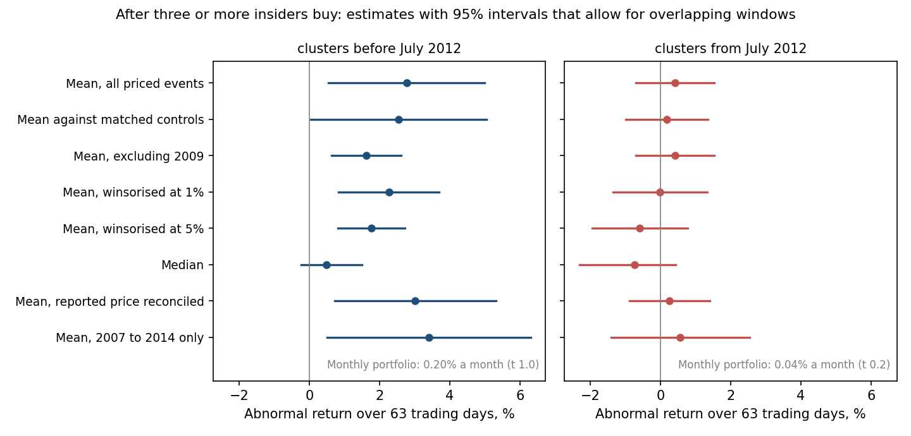
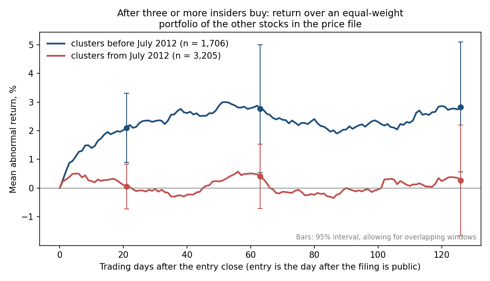
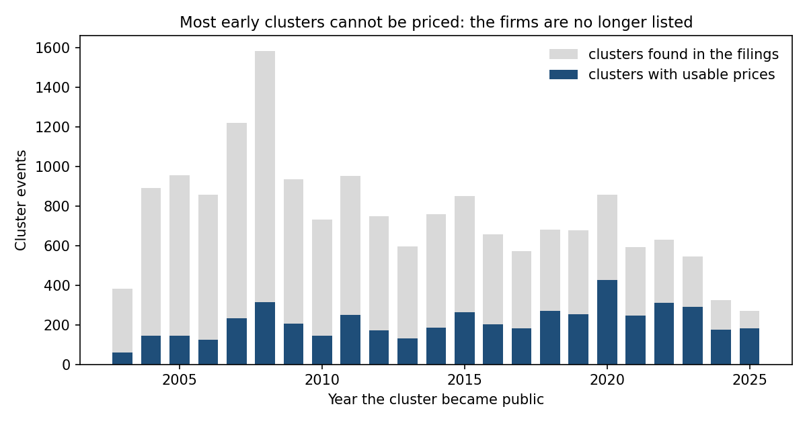
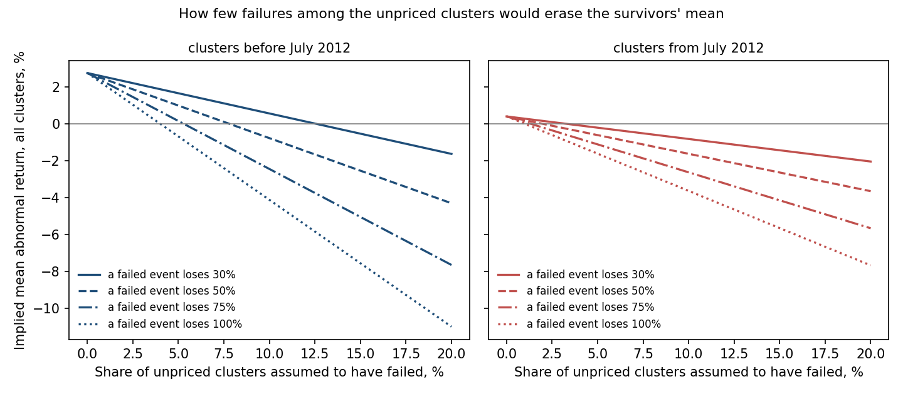

# Quorum

When three or more insiders at one company buy in the same month, does the stock go on to beat similar stocks? And did that stop after the research on it became well known in 2012?

Free data cannot settle either question. Among companies that are still listed, the stocks beat size-matched controls by 2.5% over the next three months before July 2012 (t = 2.0, 1,706 events) and by 0.2% from July 2012 on (t = 0.3, 3,205 events). The same events held as a monthly portfolio earn 0.20% a month over the benchmark before July 2012 (t = 1.0) and 0.04% after (t = 0.2). The median event before July 2012 is +0.5%, with a 95% interval from -0.2% to +1.5%. The change between the two periods is not significant in the main tests (t = -1.7 against matched controls, t = -0.6 as a monthly portfolio).



The main limit is survivorship. The free price file holds companies that were still listed in 2024 or later (all but 6 of its 12,611 price series run that far). It can price 23% of the clusters found before July 2012 and 44% of those found after. If 4% of the unpriced early clusters lost everything over the three months, the early mean is zero. At a 30% loss it takes 13%. I have no delisting data to say which is closer, so the early number is an upper bound on a quantity I cannot measure.

An earlier version of this page led with "2.8%, t = 2.7". That t-statistic clustered standard errors by entry month while the return window is three months long, so neighbouring events share most of their return days. Allowing for the overlap gives t = 2.4 against the same benchmark. The correction was smaller than the gap between the event study and the monthly portfolio, which is the larger reason to doubt the result.

## Reproduce

```
uv sync
uv run python scripts/fetch_data.py     # about 1.3 GB into data/, no account or key
uv run python scripts/reproduce.py      # about 2 minutes, writes results/
```

`reproduce.py` hashes every input file and compares it with `results/data_manifest.csv` before it does anything else. If all seven match it prints `SNAPSHOT MATCHES` and rebuilds the committed tables. If any file differs it names the file, prints `SNAPSHOT DIFFERS`, and stops. With `--accept-snapshot` it runs anyway and rewrites the manifest, and the tables will then differ from the numbers on this page.

What can be reproduced:

- The two filings files are fetched from Harvard Dataverse by file id and checked against fixed hashes. Anyone can get the same bytes.
- With the same seven input files, two runs on my machine gave byte-identical tables and figures. I have not compared machines or operating systems.
- `uv run python scripts/reproduce.py --fast` runs the whole pipeline on synthetic data in a few seconds with no downloads. CI runs it on every push. Its numbers are not findings.

What cannot:

- The price files come from a Hugging Face dataset that is rewritten daily and keeps no history. The results here use the files as downloaded on 23 November 2026. A download on any later day gives different files, and the script will say so. I could not find a way to pin them and I have not republished them, because the underlying prices are Yahoo Finance data.
- So the exact numbers on this page can only be rebuilt by someone who has that day's files. A later snapshot should give similar numbers, and I have not tested how similar.

## What the tests say

Abnormal return over 63 trading days, entering at the close of the day after the filing is public. The t-statistics allow for overlapping windows (see `PAPER.md` for the estimator).

| Test | Before July 2012 | From July 2012 | Change |
|---|---|---|---|
| Against five size-matched controls from the same price file | 2.5% (t 2.0) | 0.2% (t 0.3) | -2.4 (t -1.7) |
| Against all liquid stocks in the price file, equal weight | 2.8% (t 2.4) | 0.4% (t 0.7) | -2.4 (t -1.8) |
| Monthly portfolio, three-month hold, excess per month | 0.20% (t 1.0) | 0.04% (t 0.2) | -0.16 (t -0.6) |
| Median event, against all liquid stocks | 0.5% (-0.2 to 1.5) | -0.7% (-2.3 to 0.4) | -1.2 (-3.1 to 0.0) |

The event study and the monthly portfolio use the same events and disagree. The event study weights every event equally, so months with many clusters count for more. Late 2008 and 2009 had many. The portfolio weights every month equally. A t of 2.0 to 2.4 in one and 1.0 in the other is weak evidence for an effect among survivors, and both sit on top of the survivorship problem.

Against SPY the early number is 5.0% (t 2.2) and against IWM it is 4.1% (t 2.1). Those benchmarks are not survivors, so they flatter the event stocks. An equal-weight portfolio of all liquid stocks in the price file has a CAPM alpha of 0.46% a month before July 2012 (t = 2.6) with no signal at all.



After a 1% round-trip cost the early mean against all liquid stocks is 1.8% and the later one is -0.6%.

### How much one year and a few large winners matter

The 2009 events average 11.1% with a median of -0.9%. These rows were added after the first results and are post hoc.

| Sample or estimator (against all liquid stocks) | Before July 2012 | From July 2012 | Change |
|---|---|---|---|
| All priced events, mean | 2.8% (t 2.4) | 0.4% (t 0.7) | -2.4 (t -1.8) |
| Excluding 2009 | 1.6% (t 3.2) | 0.4% (t 0.7) | -1.2 (t -1.6) |
| Winsorised at 1% and 99% | 2.3% (t 3.1) | 0.0% (t 0.0) | -2.3 (t -2.3) |
| Winsorised at 5% and 95% | 1.8% (t 3.6) | -0.6% (t -0.8) | -2.4 (t -2.8) |
| Reported price reconciled only | 3.0% (t 2.6) | 0.3% (t 0.4) | -2.8 (t -2.1) |
| 2007 to 2014 only | 3.4% (t 2.3) | 0.6% (t 0.6) | -2.8 (t -1.6) |

Dropping 2009 cuts the early mean from 2.8% to 1.6%. It also removes most of the noise, so the t-statistic rises. Winsorising does the same. Read together, these rows say the early mean among survivors is somewhere between 1.6% and 3.4% and that its size depends on 2009. They do not rescue the result from the survivorship problem, and the monthly portfolio without 2009 is still 0.30% a month with t = 1.6. The same rows against matched controls are in `results/robustness.csv`.


By year, the mean is positive in eight of the nine years from 2003 to 2011 and in eight of the fourteen years from 2012 to 2025.

### How large the survivorship bias could be



Before July 2012 the filings hold 7,549 clusters above the $2 price floor. 5,055 of them are at companies with no prices in the file, and 1,706 can be priced. From July 2012 on the numbers are 7,234, 2,911 and 3,205.

I looked for a free source of prices for delisted US stocks that needs no key and has a clear licence. I did not find one. Every source with delisted names that I found is paid or needs an account (EODHD, Norgate, Sharadar, QuantRocket, FirstRate Data, MarketParquet), and a search of the Hugging Face dataset index for "delisted" and "survivorship" returned no price data.

So the bias is bounded instead of removed. Assume the unpriced clusters would have passed the liquidity screen at the same rate as the priced companies' clusters did (68% early, 74% late). Assume a share of them failed inside the three months and lost a fixed amount against the benchmark, and that the rest did as well as the survivors. The share that brings the mean to zero:

| Loss of a failed event | Early mean reaches zero | Late mean reaches zero | Early equals late |
|---|---|---|---|
| 30% | 12.6% | 3.4% | 24.3% |
| 50% | 7.8% | 2.0% | 15.6% |
| 75% | 5.3% | 1.4% | 10.8% |
| 100% | 4.0% | 1.0% | 8.3% |

If the unpriced clusters that did not fail earned zero instead of the survivors' mean, the early mean reaches zero at 1.4% (100% loss) to 4.5% (30% loss). The full grid is in `results/survivorship_bounds.csv`.



Three things are done to make the comparison fair inside the surviving sample. Both benchmarks are drawn from the same price file, so they carry the same condition as the event stocks. The matched controls are also close in dollar volume and have no cluster of their own within 182 days. And the 2007 to 2014 row uses years where coverage is roughly level on both sides of the split date (19% to 26% of clusters priced), a window I chose from the coverage table. None of this recovers the missing companies. If insider buying says anything about which firms fail, that part is invisible here.

### Whether filings are joined to the right prices

Filings are joined to prices by SEC CIK. As a check, the median price the insiders reported paying is compared with the closes in the price file over the 30 days of buying, after undoing later splits. An event is reconciled when the reported price lies inside that range of closes, widened by 10%.

| | Before July 2012 | From July 2012 |
|---|---|---|
| Within 25% of the split-adjusted close (the earlier check) | 63% | 82% |
| Within 25% of the close as traded | 93% | 95% |
| Reconciled | 94.4% | 96.8% |

By year the reconciled share runs from 90% (2004) to 99% (2019). The 196 events that do not reconcile are flagged in `results/cluster_events.csv` and kept in the main sample, since the sample was set before this check existed. Dropping them is the "reconciled only" row above. The unreconciled events are missing splits, private purchases away from the market price, bad filings or wrong joins, and I cannot tell these apart.

### Routine and opportunistic insiders

The split from Cohen, Malloy and Pomorski did not replicate. Opportunistic buys beat routine buys by 0.16% a month before July 2012 (t = 0.5) and by -0.08% after (t = -0.3). The paper reports 0.68% a month for 1989 to 2007. The test has little power here: the filings start in mid-2003, so the first labels are for 2006, and the buy portfolios hold about 20 stocks a month.

### Other cluster definitions

Four other definitions (two or four insiders, a 10 or 90 day window) are in `results/variants.csv`. Against matched controls the early mean runs from 0.9% to 2.9%, with t between 1.5 and 2.2. None was used to choose the main one.

## What was built

- A reader for the Layline insider trading dataset, which is built from every Form 3, 4 and 5 on EDGAR since mid-2003
- Seven cleaning rules, each one counted in `results/cleaning.csv`
- Cluster detection: three or more insiders with purchases traded in the last 30 days, dated by the day the filing that completes the cluster became public
- The routine and opportunistic split from Cohen, Malloy and Pomorski
- An event study of buy-and-hold abnormal returns over 21, 63 and 126 trading days against four benchmarks, with standard errors that allow for overlapping windows
- Monthly calendar-time portfolios with Newey-West standard errors
- Survivorship bounds, a split-aware check of the join to prices, and a table of the headline under other samples and estimators

## Data

- Filings: Layline insider trading dataset, Harvard Dataverse, doi:10.7910/DVN/VH6GVH, CC BY 4.0. Tables `lit_panel` and `lit_reportingowner`, version 430.
- Prices, dividends, splits, the CIK to ticker catalogue and Treasury yields: the `defeatbeta/yahoo-finance-data` dataset on Hugging Face, ODC-BY, sourced from Yahoo Finance.

The filings come from the Layline mirror and not from the SEC, because the SEC asks automated clients to send a contact name and email with every request and I chose not to send one. An earlier version carried an optional reader for the SEC's own quarterly files. It had never been run against the live site and its column names were unchecked, so I removed it.

No data is committed. Nothing here needs an account or a key.

## How it is tested

100 tests, none of which touch the network.

- Cluster detection on hand-built filings: the window, the cooldown, one insider buying three times, a stale trade filed late
- The routine-trader rule against the paper's definition, case by case
- No return is measured before the filing was public: rewriting every return up to the entry day leaves the result unchanged
- Buy-and-hold returns against a closed form, and Newey-West and overlap-robust standard errors against hand calculations
- A simulation with overlapping windows and a true mean of zero, where month clustering rejects far too often and the overlap-robust error does not
- Matched controls, the split adjustment and the survivorship formula on small hand-built cases
- The snapshot check: a changed file stops the run and is named
- A synthetic data set with a planted drift before the split date and none after, which the pipeline has to recover
- Running `reproduce` twice gives identical tables

## Layout

```
src/quorum/               the code
tests/                    the tests
scripts/fetch_data.py     downloads public data into data/ (never committed)
scripts/reproduce.py      checks the input hashes, then rebuilds every figure and table
results/                  committed figures and small tables
PAPER.md                  citations, formulas, comparison with the sources, what was chosen when
```

## Limits

- Delisted companies are missing, and more of them are missing early. This is the main limit and it is covered above.
- The two periods differ in coverage (23% and 44%), so a difference between them could come from the data alone.
- The evidence for an effect among survivors depends on the test. Event-time means give t between 2.0 and 3.6. The monthly portfolio gives 1.0 and the median's interval includes zero.
- Everything added after the first results is post hoc: the overlap-robust errors, matched controls, the 2009, winsorised, reconciled and 2007 to 2014 rows, and the survivorship bounds. `PAPER.md` lists what was set when.
- Size is matched on dollar volume. There are no market capitalisations in the data.
- Costs are a flat 1% per round trip. That is an assumption. Small stocks can cost more.
- Prices come from Yahoo Finance through a third party. The code drops 773 isolated price spikes and blanks 322 one-day moves above tenfold. Other errors may remain.
- The original papers used commercial data over 1975 to 2007. This is a different source and a different period, so it is a test of the idea and a long way from an exact replication.
- Filings are as filed. The SEC does not guarantee their accuracy.
- This is research code. It is not investment advice and it does not trade.

## Sources

- Lakonishok and Lee, "Are Insider Trades Informative?", Review of Financial Studies 14(1), 2001
- Cohen, Malloy and Pomorski, "Decoding Inside Information", Journal of Finance 67(3), 2012
- Balogh, "Insider trading", Scientific Data 10, 2023 (the dataset paper)

Every number that differs from a source is listed in `PAPER.md` with the likely reason.

The name: a quorum is the number of members who must be present before a vote counts.

## Licence

MIT. See `LICENSE`.
