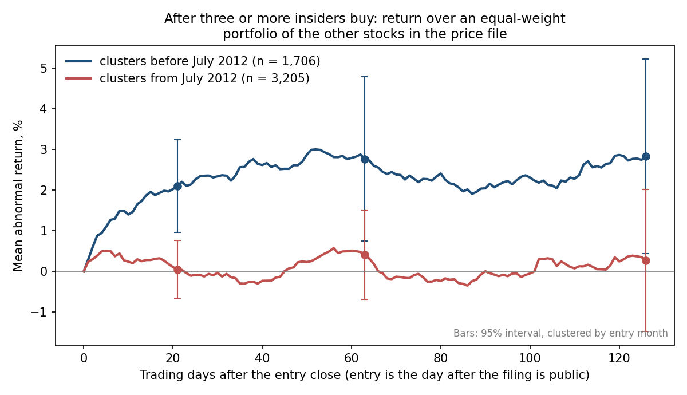
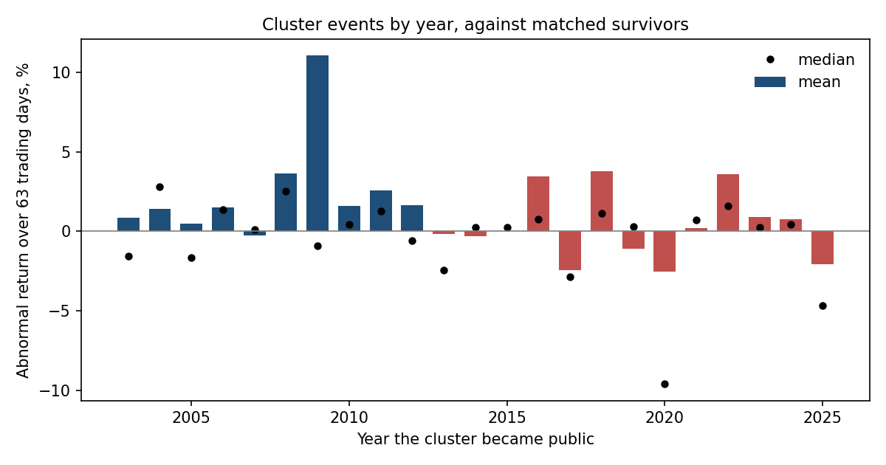

# Quorum

**When several insiders at one company buy in the same month, what happens next?**

Before July 2012, a stock where three or more officers or directors bought within 30 days went on to beat comparable stocks by 2.8% over the next three months (t = 2.7, 1,706 events). From July 2012 on, the figure is 0.4% (t = 0.7, 3,205 events). The drop of 2.4 points has a t-statistic of -2.0, and it is not significant when the same events are held as a monthly portfolio (t = -0.6).

Read that with one fact in mind. The free price data only covers companies that are still listed. It can follow 15% of the clusters from 2003 to 2006 and 68% of those from 2025. Every number here describes survivors.



The median event shows much less than the mean: +0.5% before July 2012 and -0.7% after. A minority of large winners carries the early average. After a 1% round-trip cost the early mean is 1.8% and the later one is -0.6%.

The split between routine and opportunistic insiders did not replicate. Opportunistic buys beat routine buys by 0.16% a month before July 2012 (t = 0.5) and by -0.08% after (t = -0.3). Cohen, Malloy and Pomorski report 0.68% a month for 1989 to 2007.

## Reproduce

```
uv sync
uv run python scripts/fetch_data.py     # about 1.3 GB into data/, no account or key
uv run python scripts/reproduce.py      # about 4 minutes, writes results/
```

`uv run python scripts/reproduce.py --fast` runs the whole pipeline on synthetic data in a few seconds, with no downloads. Its numbers are not findings.

## The question

Executives must report their own trades. The research says clusters of buying predicted returns. That research is now well known. Does the effect still exist?

In this sample the answer is: it was there before 2012 and I cannot find it after. I would not lean on the size of the early number, because of the survivorship problem above.

## What was built

- A reader for the Layline insider trading dataset, which is built from every Form 3, 4 and 5 on EDGAR since mid-2003
- Seven cleaning rules, each one counted in `results/cleaning.csv`
- Cluster detection: three or more insiders with purchases traded in the last 30 days, dated by the day the filing that completes the cluster became public
- The routine and opportunistic split from Cohen, Malloy and Pomorski
- An event study of buy-and-hold abnormal returns over 21, 63 and 126 trading days, with a flat 1% round-trip cost
- Monthly calendar-time portfolios with Newey-West standard errors
- An optional reader for the SEC's own quarterly files (see Data)

## Results in more detail

Abnormal return over 63 trading days, entering at the close of the day after the filing is public:

| Benchmark | Before July 2012 | From July 2012 | Change |
|---|---|---|---|
| Equal-weight portfolio of the other stocks in the price file | 2.8% (t 2.7) | 0.4% (t 0.7) | -2.4 (t -2.0) |
| SPY | 5.0% (t 2.8) | 0.7% (t 0.7) | -4.3 (t -2.2) |
| IWM | 4.1% (t 2.8) | 1.0% (t 1.6) | -3.1 (t -2.0) |

The first row is the one I trust most. Its benchmark is drawn from the same price file as the event stocks, so both sides are survivors. Against SPY the survivors look better than they should: an equal-weight portfolio of all the liquid stocks in the file has a CAPM alpha of 0.46% a month before July 2012 (t = 2.6) with no signal at all.

Monthly portfolios tell a weaker story than the event study. A portfolio that holds each cluster stock for three months beat the equal-weight benchmark by 0.20% a month before July 2012 (t = 1.0) and by 0.04% after (t = 0.2). The event study weights every event equally, so busy months such as late 2008 and early 2009 count for more. The portfolio weights every month equally.

By year, the mean is positive in eight of the nine years from 2003 to 2011 and in eight of the fourteen years from 2012 to 2025. The 2009 mean of 11.1% sits next to a median of -0.9%.



Four other cluster definitions give the same picture (two or four insiders, a 10 or 90 day window). All are in `results/variants.csv`. None was used to choose the main one.

## Sources

- Lakonishok and Lee, "Are Insider Trades Informative?", Review of Financial Studies 14(1), 2001
- Cohen, Malloy and Pomorski, "Decoding Inside Information", Journal of Finance 67(3), 2012
- Balogh, "Insider trading", Scientific Data 10, 2023 (the dataset paper)

Every number that differs from a source is listed in `PAPER.md` with the likely reason.

## Data

The design called for the SEC's Insider Transactions Data Sets. The SEC asks automated clients to send a contact name and email with every request, and I chose not to send one. So the filings come from an open mirror instead, and the question is unchanged: same forms, same fields, from mid-2003.

- Filings: Layline insider trading dataset, Harvard Dataverse, doi:10.7910/DVN/VH6GVH, CC BY 4.0. Tables `lit_panel` and `lit_reportingowner`, version 430. Fetched by file id and checked against a fixed hash.
- Prices, dividends, the CIK to ticker catalogue and Treasury yields: the `defeatbeta/yahoo-finance-data` dataset on Hugging Face, ODC-BY. It is sourced from Yahoo Finance. It is rewritten daily and keeps no history, so it cannot be pinned. The published results use the snapshot of 23 November 2026, and its hashes are in `results/data_manifest.csv`. A later download will give slightly different numbers.

The direct SEC path is written and tested against mocked requests, and has never been run against the live site. To use it, set `SEC_USER_AGENT` yourself and run `fetch_data.py --source edgar`, then `reproduce.py --source edgar`. It refuses to make a request while the variable is unset.

No data is committed. Nothing here needs an account or a key.

## How it is tested

71 tests, none of which touch the network.

- Cluster detection on hand-built filings: the window, the cooldown, one insider buying three times, a stale trade filed late
- The routine-trader rule against the paper's definition, case by case
- No return is measured before the filing was public: rewriting every return up to the entry day leaves the result unchanged
- Buy-and-hold returns against a closed form, and Newey-West and clustered standard errors against hand calculations
- A synthetic data set with a planted drift before the split date and none after, which the pipeline has to recover
- Running `reproduce` twice gives identical tables

## Layout

```
src/quorum/      the code
tests/             maths tests first
scripts/reproduce.py   one command rebuilds every figure and table
scripts/fetch_data.py  downloads public data into data/ (never committed)
scripts/check_mapping.py  compares filed prices with the price file
results/           committed figures and small tables
PAPER.md           citations, claims tested, comparison with the sources
```

## Roadmap

- [x] Project skeleton, CI, and the reproduce command
- [x] A loader for insider transaction data (the Layline mirror, plus an untested-on-live-data reader for the SEC's quarterly files)
- [x] Cleaning rules, written down
- [x] Cluster detection: three or more insiders buying within a window
- [x] The split between routine and opportunistic traders
- [x] Event-study returns against the market with costs, before and after 2012
- [x] `PAPER.md` comparison with the sources
- [x] Results and limits written up at the top of this file

## Limits

- Delisted companies are missing. Of 17,266 clusters found in the filings, 4,911 could be priced. A company that went bankrupt after its insiders bought is not in the sample, and that flatters any strategy that buys. The matched benchmark shares the bias but cannot remove it: if insider buying says anything about which firms survive, that part is invisible here.
- The bias is uneven across the split. An event from 2005 is in the sample only if the firm lasted about twenty more years. An event from 2022 needed about three. That alone could produce a "decay", and I cannot rule it out with this data.
- The evidence for a change is thin. A t-statistic of -2.0 in event time and -0.6 in calendar time is not a settled result.
- Filings are joined to prices by SEC CIK. For events from 2021 on, the price insiders reported paying is within 25% of the close in the price file 89% of the time (`results/mapping_check.csv`). The rest are later splits, private purchases at a discount, or wrong joins, and I have not separated them.
- The routine and opportunistic test has little power here. The filings start in mid-2003, so the first labels are for 2006, and the buy portfolios hold about 20 stocks a month.
- Costs are a flat 1% per round trip. That is an assumption. Small stocks can cost more.
- Prices come from Yahoo Finance through a third party. The code drops 773 isolated price spikes and blanks 322 one-day moves above tenfold. Other errors may remain.
- The original papers used commercial data over 1975 to 2007. This is a different source and a different period, so it is a test of the idea and a long way from an exact replication.
- Filings are as filed. The SEC does not guarantee their accuracy.
- This is research code. It is not investment advice and it does not trade.


## The name

A quorum is the number of members who must be present before a vote counts. One insider buying is an anecdote.

## Licence

MIT. See `LICENSE`.
